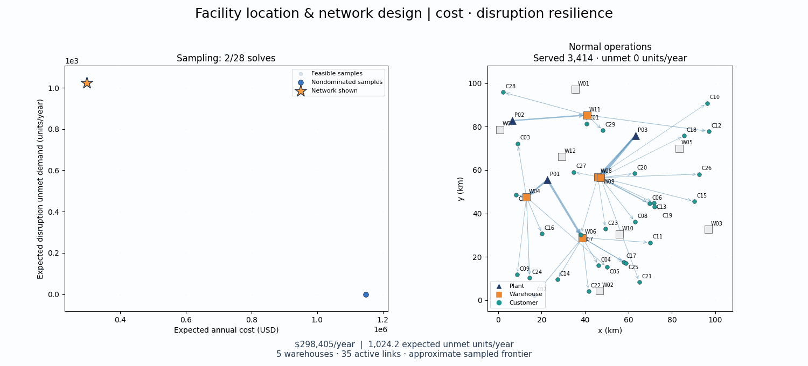

# Two-objective facility location & network design

Choose warehouses and transport links, then adapt shipments to normal operations and disruptions. This Python application minimizes **expected annual cost** and **expected disruption unmet demand** using a genetic algorithm with **NSGA-II** for network search and Pyomo/HiGHS linear programs for scenario dispatch.



The bundled GIF is the historical MILP demonstration; new CLI and dashboard searches use NSGA-II. The left panel shows cost versus expected disruption unmet demand; lower values are better on both axes. The orange star selects the allocation on the right. The animation first shows completed optimization samples, then tours the final sampled frontier under normal operations and each design's worst sampled disruption. Arrows show positive shipments; gray warehouses are closed and red warehouses have failed. Objective axes remain fixed during sampling and zoom once for the final tour.

A larger NSGA-II run is available locally at `results/nsga2_frontier/network_tradeoffs.gif` (48 individuals, 40 generations, seed 42). It found 59 audited nondominated designs, ranging from $348,106/year with 992.7 expected unmet units/year to $470,627/year with zero modeled shortfall. These are search results, not certified global optima. The old `nsga2_smoke` GIF used only 8 individuals and 2 generations.

## Install and launch

Python 3.9+ is supported; Python 3.11+ is recommended. No paid solver, external dataset or service credentials are needed. From the repository root in a macOS/Linux shell:

```sh
python3 -m venv .venv
source .venv/bin/activate
python -m pip install --upgrade pip
pip install -e '.[test]'
pytest -q
streamlit run app.py
```

Open the local URL printed by Streamlit, normally `http://localhost:8501`. The dashboard loads the shipped dataset and previously solved frontier without running an optimization. If HiGHS is unavailable, reinstall the project dependencies with `pip install -e '.[test]'`; `highspy` is included.

For the exact dependency versions recorded locally, install `pip install -r requirements-lock.txt` and then `pip install -e . --no-deps`. The lock file was captured with Python 3.9.6 on macOS arm64; other Python/platform combinations may need compatible versions instead.

## Explore designs in the dashboard

Select a saved design or click a point in the 2D cost/resilience plot to inspect its allocation. Choose normal operations or a disruption to see scenario flows, fulfilled demand and unmet demand. Compare multiple designs and download their facility decisions, activated links, scenario flows and metrics.

Use **Generate Pareto frontier** to run NSGA-II. The sidebar controls population size, generation count, random seed, and dispatch time limit. Defaults are **48 individuals**, **40 generations**, seed **42**, uniform crossover probability **0.9**, and per-bit mutation probability **1 / number of binary genes**. The initial population plus offspring require up to 1,968 dispatch evaluations; duplicate chromosomes reuse cached results.

**Solve selected design** remains an explicitly labeled MILP benchmark for weighted preferences or resilience bounds. Saved historical MILP samples remain viewable and are labeled in the dashboard. Changing a widget does not automatically start a search.

## Generate results from the command line

Regenerate a frontier and GIF from the shipped input:

```sh
network-design --instance data/example_instance.json \
  --output results/network_design --time-limit 8 --population-size 48 --generations 40 --seed 42
```

The CLI verifies feasibility, evolves the population, and saves evaluated candidates, generation summaries, the nondominated archive, and CSV exports. Use `--mutation-rate` and `--crossover-rate` to override genetic operator defaults. A dispatch LP's `optimal` status certifies only that chromosome's scalar dispatch evaluation, never global network optimality.

For a quick run on the hand-checkable instance:

```sh
network-design --instance data/tiny_instance.json \
  --output results/tiny --time-limit 5 --population-size 8 --generations 3
```

Generate and solve a different synthetic instance:

```sh
network-design --generate --instance results/custom_instance.json --seed 7 \
  --plants 3 --warehouses 8 --customers 20 --scenarios 10 \
  --output results/custom --time-limit 30 --population-size 40 --generations 30
```

Existing inputs are reused unless `--generate` is specified; size and seed arguments apply when generating an input. Add `--no-gif` to skip animation rendering. Use a new output directory for each experiment so design folders from earlier runs are not mixed with new ones. Run `network-design --help` for all options.

## The two-objective model

The default seed-42 instance has **3 plants, 12 candidate warehouses, 30 customer zones, 396 eligible directed links, and 10 scenarios**. Normal operations have probability 0.7; nine disruptions share probability 0.3. Total annual demand is 3,414 units. Disruptions include warehouse outages, a plant supply reduction, a link outage and multi-asset losses.

| Objective | Definition | Units |
| --- | --- | --- |
| `cost` | Warehouse opening + link activation + probability-weighted shipment cost | USD/year |
| `expected_unmet_demand` | Probability-weighted unmet demand summed over disruption scenarios | Units/year |

Warehouse and link binaries are shared across scenarios; shipments and shortfalls adapt to each scenario. Constraints enforce plant supply, warehouse flow balance and throughput, link activation/capacity, links to opened warehouses and customer demand balance. **All normal demand must be served.** Fixed costs are paid once for the annual network, rather than once per scenario. Each scenario describes an alternative condition for that same year.

The optimized resilience loss is **unconditional**. Conditional disruption shortfall divides it by total disruption probability; conditional unmet percentage also divides by total customer demand. With the default probabilities, an optimized loss of 1,024.2 units/year corresponds to conditional unmet demand of 3,414 units/year, or 100%. Aggregate arc flow counts shipments on both transportation legs; fulfilled demand counts deliveries only.

There is no unmet-demand penalty in cost. A cost-only design can choose to ship nothing during disruptions to save transportation cost. The resilience objective or its epsilon bound controls this behavior. The model includes one product and no inventory, direct plant-to-customer shipping or capacity expansion. Resilience measures expected shortfall, not worst-case reliability or CVaR. All operational inputs are synthetic teaching assumptions.

## NSGA-II architecture and interpretation

A chromosome contains binary warehouse-opening and shipping-link genes plus a dispatch-preference gene in [0, 1]. Repair disables links attached to closed warehouses. After dispatch, the decoder removes links unused across all scenarios and warehouses with no used links, preserving feasibility and recomputing costs. These decoded decisions are inherited by offspring. Newly opened warehouses receive incident links so mutations can use their capacity. The initial population includes two fully activated networks and random networks of varying density with stratified preferences. No MILP anchor is used to seed or normalize NSGA-II. The GIF renders a bounded number of generation checkpoints and shows nondominated samples as unconnected points.

For each chromosome, facility and link decisions are fixed and the remaining continuous dispatch problem is solved across all scenarios. The preference gene controls the cost/shortfall scalarization **inside the evaluator**; NSGA-II selection always compares the two physical objectives separately. The preference maps logarithmically to a shortfall penalty in USD/unit, with zero as the cost-only endpoint. This spreads candidates across operational trade-offs instead of concentrating linear weights at zero shortfall. No optimized anchors are used. This is a hybrid GA + LP architecture, not a pure GA over every shipment variable.

Binary tournament selection uses nondomination rank and crowding distance. Uniform crossover combines network bits; arithmetic crossover combines dispatch preferences. Duplicate objective vectors are excluded from survival unless needed to fill the population. Bit-flip mutation and random preference mutation introduce variation. Elitist survival sorts the combined parent/offspring population into nondominated fronts and uses crowding distance when a front does not fit. Feasible candidates dominate candidates without audited feasible dispatch. Infeasible candidates tie at the last rank; no softening of normal-service constraints is used. A separate archive retains all discovered nondominated objective vectors.

Every accepted design is independently audited against capacity, flow balance, activation, normal demand, scenario shortfall and objective calculations. Finite populations and generations provide an approximate front, with no guarantee of convergence, completeness, or global optimality. Dispatch preferences sample possible recourse policies and may miss additional trade-offs for a fixed network. Larger populations and more generations can improve exploration at additional evaluation cost.

### Historical MILP benchmark

The previous anchor/weighted/epsilon search is retained as `network_design.multiobjective.sampled_frontier`; individual solves remain in `network_design.solve`. The bundled `examples/network_design` archive and GIF were produced by that older method and have not been relabeled as GA results.

The shipped run returned **21 sampled nondominated designs** from 28 attempts: 19 terminated optimal within tolerance and 9 reached their time limit with feasible incumbents. All 28 passed the independent feasibility and objective audit. Its sampled extremes are:

| Sampled design | Expected annual cost | Expected disruption unmet demand |
| --- | ---: | ---: |
| Lowest sampled cost | $298,339.74 | 1,024.2 units/year |
| Lowest sampled shortfall | $401,456.76 | 0 units/year |

These are an **approximate sampled Pareto frontier**, not a certificate of completeness or global Pareto optimality. Weighted sums can miss unsupported MILP solutions; finite epsilon sampling and time-limited incumbents add further limits. Single-objective ties are not resolved lexicographically, so resilience-only anchors can contain unused facilities or expensive alternative allocations.

Solver termination `optimal` can mean optimal within the configured relative MIP gap. Bounds and gaps apply to the objective actually solved: normalized scalar cost/resilience for weighted sums, physical cost for epsilon solves, or the chosen individual objective. Reported cost and shortfall always retain their physical units. Identical seeds do not guarantee identical time-limited decisions across machines; the saved results preserve the demonstrated allocations.

## Files and documentation

| Location | Contents |
| --- | --- |
| [Problem specification](docs/sample_problem.md) | Sets, variables, objective equations, constraints and acceptance criteria |
| [Input guide](data/README.md) | Schema-v2 JSON fields, units, scenarios and the hand-checkable example |
| [Saved demonstration](examples/network_design/README.md) | GIF, static preview, actual results and export layout |
| [Validation record](VALIDATION.md) | Local checks, solver outcomes and limitations |
| [Contributor guide](CONTRIBUTING.md) | Module responsibilities and development workflow |
| `src/network_design/` | Data, model, solver, Pareto methods, reporting, visualization and CLI modules |
| `app.py` | Streamlit dashboard |
| `tests/` | Model arithmetic, solver, Pareto, exports and dashboard tests |
| `results/` | Locally generated output, ignored by Git |

MIT licensed; synthetic inputs use the same license.
