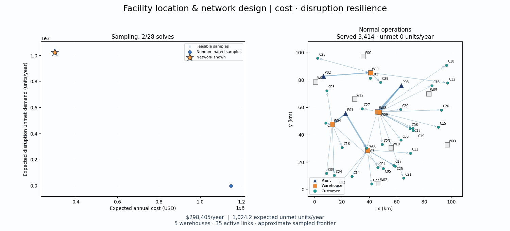

# Saved cost/resilience demonstration

This directory contains the actual seed-42 **two-objective** run used by the dashboard. Its objectives are expected annual `cost` and unconditional `expected_unmet_demand` during disruptions. The exact input is bundled as [instance.json](instance.json); it matches [the shipped default dataset](../../data/example_instance.json).



The GIF shows accumulated completed optimization samples, then tours representative final designs under normal operations and each design's worst sampled disruption. The orange star selects the allocation on the right. This is a sampled MILP frontier, not an evolutionary search or a proof of global Pareto optimality. [network_tradeoffs.png](network_tradeoffs.png) is a static preview.

## Recorded run

| Setting or outcome | Value |
| --- | --- |
| Input/result schema | 2 |
| Seed | 42 |
| Plants / warehouses / customers / scenarios | 3 / 12 / 30 / 10 |
| Annual demand | 3,414 units |
| Time limit per solve | 8 seconds |
| Relative MIP gap target | 0.01 (1%) |
| Frontier attempts | 28: 2 anchors + 5 weighted sums + 21 resilience thresholds |
| Optimal within tolerance | 19 |
| Time limits with feasible incumbents | 9 |
| Infeasible or missing-incumbent attempts | 0 |
| Unique nondominated sampled designs | 21 |

The CLI also performs a preliminary feasibility solve, which is not included in the 28 recorded frontier attempts. All recorded designs passed the independent audit. A time-limited incumbent is a feasible candidate, not a certified optimum; anchor gaps also make normalization values incumbent estimates. The [validation record](../../VALIDATION.md) explains these limits.

## Files and exports

| File | Contents |
| --- | --- |
| [instance.json](instance.json) | Exact schema-v2 synthetic input |
| [results.json](results.json) | Objective keys, configuration, payoff-table normalization, every attempt and filtered frontier |
| [pareto_front.csv](pareto_front.csv) | One row per sampled nondominated design, physical metrics and solver metadata |
| [network_tradeoffs.gif](network_tradeoffs.gif) | Animated frontier/selected-allocation comparison |
| [network_tradeoffs.png](network_tradeoffs.png) | Static final-frame preview |
| `<design_id>/metrics.csv` | Cost, expected shortfall, conditional shortfall/percentage and solver status/bounds/gap/runtime |
| `<design_id>/facilities.csv` | Every candidate warehouse, input parameters and `opened` decision |
| `<design_id>/links.csv` | Every eligible directed arc, input parameters and `activated` decision |
| `<design_id>/flows.csv` | Shipments by arc and scenario, including zeros |
| `<design_id>/unmet.csv` | Unmet demand by customer and scenario |
| `<design_id>/scenarios.csv` | Scenario probabilities, fulfilled/unmet demand, shipment cost and aggregate arc flow |

Only filtered-front designs receive individual CSV folders. JSON `attempts` preserves all scalarized solves; `front` preserves only the unique nondominated subset. Each feasible design record contains `design_id`, `method`, `settings`, `solver`, `dimensions`, `objectives`, `opened_warehouses`, `activated_arcs`, `shipments`, `unmet_demand` and `diagnostics`. Attempts with no incumbent have `objectives: null` and a diagnostic instead of extracted network flows.

The top-level `objective_keys` is `["cost", "expected_unmet_demand"]`. The `objectives` dictionary always contains physical values in USD/year and units/year. Solver bounds/gaps refer to each solve's actual scalar objective; weighted-sum bounds are normalized and cannot be read as monetary bounds. Scenario flows can differ between equally good solutions because no lexicographic tie-break is imposed.

## Inspect or reproduce

From the repository root with the environment activated:

```sh
streamlit run app.py
```

The dashboard loads this saved run automatically. To generate a new run without overwriting these examples:

```sh
network-design --instance data/example_instance.json \
  --output results/network_design --time-limit 8 --mip-gap 0.01 --grid 21
```

Time limits and solver/platform differences can change returned incumbents even with the same input. Use the saved JSON to inspect the exact illustrated allocations. A quick Python inspection does not require solving:

```python
import json
from pathlib import Path

archive = json.loads(Path("examples/network_design/results.json").read_text())
for design in archive["front"]:
    print(design["design_id"], design["objectives"], design["solver"]["termination_condition"])
```

See [the main README](../../README.md), [input guide](../../data/README.md), and [full formulation](../../docs/sample_problem.md) for setup, units and constraints.
